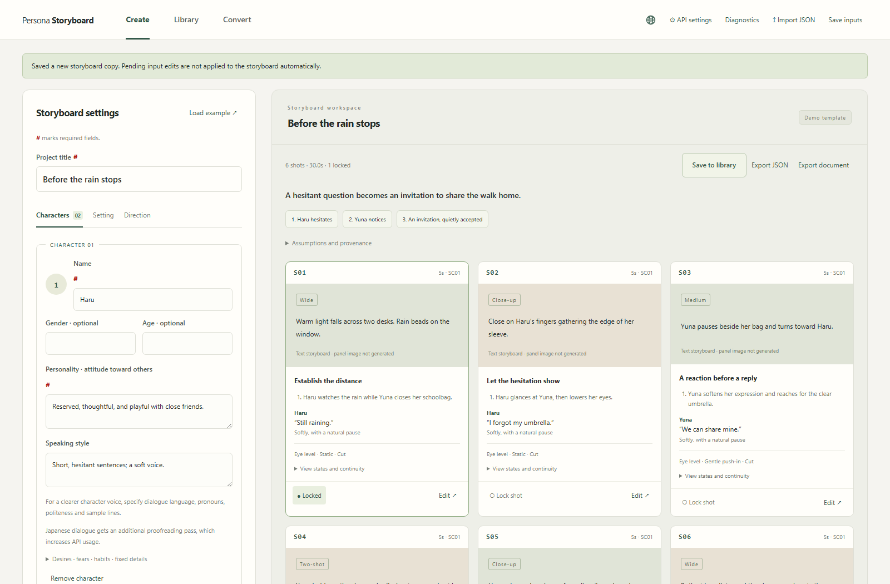
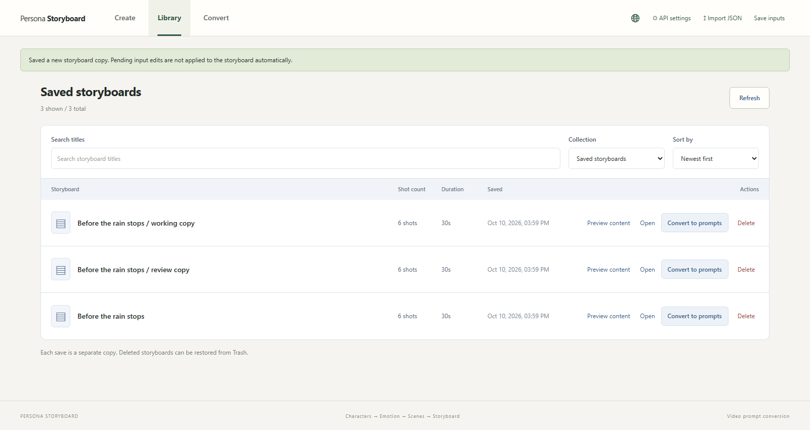
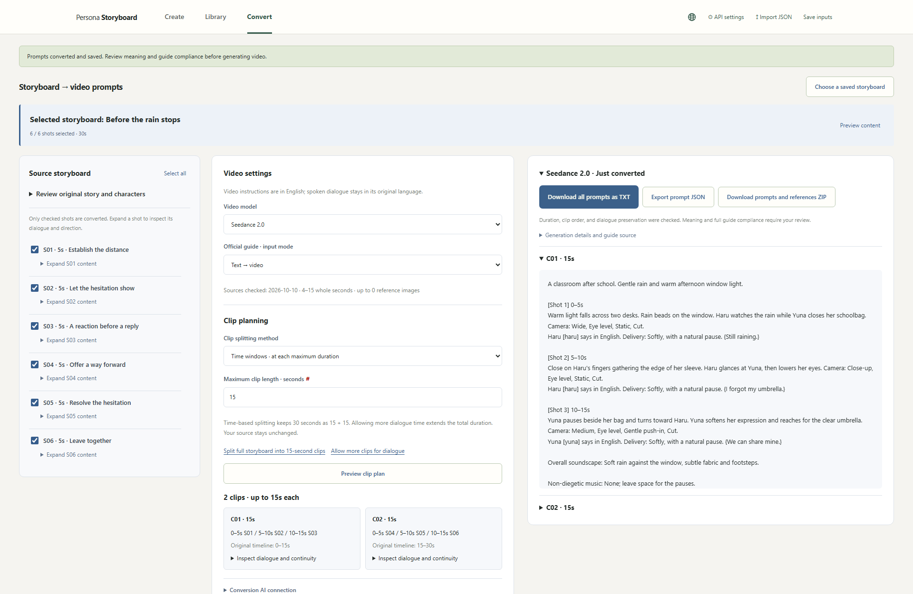
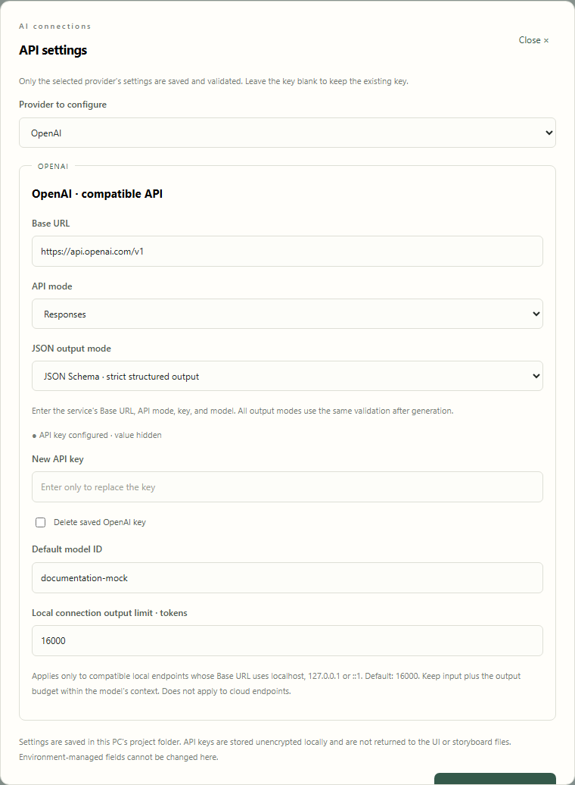

# AI Video Storyboard Generator

[English](README.md) · [한국어](README.ko.md) · 日本語

キャラクターの性格や話し方から、編集可能なストーリーボードを作成するローカルWebアプリです。登場人物は1〜5人まで設定でき、選んだカットをSeedance 2.0やMiniMax H3向けの動画プロンプトに変換できます。

**v0.5.4-beta** — PC上で動かすダウンロード版です。作成するのはテキストのストーリーボードとプロンプトです。動画の生成や、カットごとのイラスト作成は含まれません。



キャラクターの性格と話し方を設定すると、カットごとの動作、セリフ、カメラ演出、場面の連続性を検討できます。生成後は各カットを編集でき、残したいカットを固定してから再生成することもできます。

[ベータ版をダウンロード](https://github.com/impacifist/ai-video-storyboard-generator/releases/tag/v0.5.4-beta) · [更新内容（英語）](docs/releases/v0.5.4-beta.md) · [サンプルのストーリーボード](examples/before-the-rain-stops.storyboard.json) · [変換済みプロンプトの例](examples/before-the-rain-stops.prompts.txt)

このバージョンでは、LM Studioに加え、OllamaとローカルのOpenAI互換接続でも出力トークン上限を設定できます。リクエストの診断ログ、応答の打ち切りや推論予算に関する案内、クリップの長さの調整、背景参照画像、最大60カットの分割生成にも対応しています。ローカルLLMには固定のソケット待機時間制限を設けていません。[カメラ技法75選と参考画像（韓国語）](docs/assets/camera-techniques-ko/README.md)も同梱しています。

スクリーンショットは、実際のアプリに手作業で用意した英語サンプルとテスト用の模擬AI応答を表示したものです。有料AIへの送信は行っておらず、実際のモデルの生成品質を示すものではありません。以下の操作名は英語画面に合わせています。

## 起動方法

**Python 3.12以降**をインストールし、リリースのZIPを展開してください。Windowsでは`start.bat`を実行します。ターミナルから起動する場合は、展開したフォルダーで次のコマンドを実行します。

```sh
python server.py
```

ブラウザーで **http://127.0.0.1:8765** を開きます。終了するときはターミナルでCtrl+Cを押してください。ポートが使用中の場合は`python server.py --port 8766`で変更できます。

アプリの実行に追加のPythonパッケージは必要ありません。テンプレートのデモはAPIキーなしで試せますが、入力した独自のキャラクター設定をAIで解釈する機能はありません。AIへのリクエストが失敗しても、デモの結果に置き換えることはありません。

## 基本の使い方

1. **API settings**でOpenAI、OpenAI互換サービス、Claude、Ollama、LM Studioのいずれかを設定します。モデルIDは、そのサービスやローカルサーバーで実際に利用できるものを入力してください。設定の保存だけではAIを呼び出しません。
2. 登場人物を1〜5人登録し、性格、話し方、人物同士の関係、場所、状況、物語の方向性を入力します。目標尺は10〜180秒、カット数は3〜60です。尺に応じた推奨カット数は、構成を考えるための目安です。
3. 生成したカットを確認し、必要に応じて編集・固定します。**Manage**では保存済みのストーリーボードを検索、プレビュー、再編集でき、ごみ箱への移動や復元もできます。
4. **Convert**で変換するカットとSeedance 2.0またはMiniMax H3のガイドを選びます。**Suggest clip lengths**で長さを提案させた後、クリップごとの秒数を調整し、分割を適用してからプロンプトを生成します。15秒固定の分割などは**Advanced splitting**にあります。
5. 必要であればキャラクターと背景の参照画像を追加し、用途と添付順を設定します。変換結果はTXT、JSON、参照画像付きZIPでダウンロードできます。

UIは英語・韓国語・日本語に対応しています。初期表示は英語で、地球アイコンから選んだ言語は次回の起動時にも引き継がれます。入力内容や元のセリフは、UIの言語を変えても翻訳されません。

### 長いストーリーボードの生成

13カット以上のAI生成・再生成では、まず物語全体の流れを設計し、直前のカットと固定済みカットの情報を引き継ぎながら、最大6カットずつ詳細化します。API呼び出し回数と費用は増えます。すべてのまとまりが検証を通過してから完成版を返し、途中までの結果を完成品として返すことはありません。出力予算は接続設定に従い、既定値は16,000トークンです。

### キャラクターの話し方と日本語のセリフ

性格や話し方に加え、性別と年齢も任意で指定できます。日本語のセリフには、一人称、相手の呼び方、敬語の程度、口調の例を記入すると意図を伝えやすくなります。

編集可能な日本語のセリフがある場合、生成・再生成後にAIによる追加の校正を行います。長い一覧は最大12行ずつ処理するため、API使用量が増えます。固定済みのカットや、入力で原文どおりの使用を指定したセリフは校正対象から外します。校正に失敗した場合は元のセリフを残し、確認を促すメッセージを表示します。自然な日本語を保証する機能ではないため、最終確認を行ってください。動画プロンプトへの変換では、承認したセリフをそのまま保持します。

## 画面で見る使用例

### 保存した作品を管理する

タイトルを検索して内容を確認し、編集画面や変換画面へ移動できます。保存のたびに別のスナップショットを作成します。削除はごみ箱への移動なので、後から復元できます。



### 30秒のストーリーボードを2本のプロンプトにする

サンプルでは、ハルがユナを一緒に帰ろうと誘うまでを、各5秒・全6カットで描いています。保存済みのサンプルを選び、15秒単位で分割すると、**C01：0〜15秒**と**C02：15〜30秒**の2本になります。

Seedance 2.0またはMiniMax H3を選び、対応する内蔵ガイドを適用します。横幅の広い画面では、元のカット、分割計画、変換結果を並べて確認できます。全クリップを1つのTXTにまとめるほか、JSONや参照画像付きZIPも書き出せます。画像参照モードでは、1人のキャラクターに複数枚の画像を指定し、それぞれの用途、メモ、添付順を設定できます。



試すには[サンプルJSON](examples/before-the-rain-stops.storyboard.json)を保存し、**Import JSON → Save to library**で読み込んでください。確認と編集にはAPIキーは不要です。実際のAIでプロンプトを変換するには接続設定が必要です。[同梱のTXT](examples/before-the-rain-stops.prompts.txt)はテスト用の模擬応答から作成した出力例です。

### 利用するAIを設定する

ブラウザーから接続先を設定できます。OpenAI互換接続では、Base URL、API方式、JSON出力方式を指定できます。Claude、Ollama、LM Studioには個別の設定欄があるため、使うサービスだけを設定してください。



## AI接続の設定

### ローカルLLMの出力上限

OllamaとLM Studioは、各設定の**Requested output limit**で変更します。その他のローカルOpenAI互換サーバーは、OpenAI設定の**Local connection output limit**を使用してください。接続ごとに保存され、生成・検査・変換に適用されます。既定値は16,000、設定範囲は256〜131,072トークンです。

Ollamaには`options.num_predict`、互換Chat Completionsには`max_tokens`、Responsesには`max_output_tokens`を送ります。OpenAI互換接続のローカル出力上限は、`localhost`、`127.0.0.1`、`::1`にのみ適用し、クラウド接続の上限は変更しません。対応する環境変数は`OLLAMA_MAX_TOKENS`、`LMSTUDIO_MAX_TOKENS`、`OPENAI_LOCAL_MAX_TOKENS`です。

この設定は出力予算であり、モデルのコンテキスト長や推論モードの設定ではありません。推論モデルでは、内部推論と最終回答が同じ予算を使うことがあります。入力トークン数と出力上限の合計が、読み込んだモデルのコンテキストに収まるようにしてください。終了理由が`length`で、ほぼすべての出力トークンが推論に使われている場合は、コンテキスト長だけでなくモデル側の推論設定も確認します。上限を増やしても完了は保証されません。打ち切られた応答の自動再送や、非対応の推論制御パラメーターの送信は行いません。

### LM Studio

LM StudioのDeveloperタブでモデルを読み込み、サーバーを起動します。アプリの**API settings → LM Studio**で、そのサーバーのモデルIDを入力してください。既定のBase URLは`http://127.0.0.1:1234/v1`です。

Chat CompletionsとJSON Schemaを既定で使用し、JSONモードやプロンプトだけでJSONを指定する方式も選べます。APIキーはLM Studio側で認証を有効にした場合に必要です。OpenAIの認証情報とは別に管理し、接続先はループバックアドレスのみを受け付けます。出力品質やスキーマへの対応はモデルに依存します。

公式資料：[OpenAI互換API](https://lmstudio.ai/docs/developer/openai-compat)、[構造化出力](https://lmstudio.ai/docs/developer/openai-compat/structured-output)、[認証](https://lmstudio.ai/docs/developer/core/authentication)。

### OpenAI互換サービスと認証情報

サービスが案内するAPIの基本URLをBase URLに入力します。通常は`/chat/completions`や`/responses`まで含めません。サービスとモデルに合わせてChat CompletionsまたはResponses、対応するJSON出力方式を選択してください。すべての互換サービスが、すべての方式に対応しているわけではありません。

認証情報はWeb UIで設定するか、`.env.example`を`.env`にコピーして必要な接続先だけ記入します。設定の優先順位は**プロセス環境変数 → Web設定 → .env**です。環境変数で管理されている項目はUIから変更できません。

UIで保存したAPIキーは、PC内の`.local-secrets/ui-settings.json`に**暗号化せず保存**します。Gitとエクスポートの対象には含めません。プロジェクトフォルダーへのアクセスを管理してください。サーバーはループバックで待ち受ける個人利用向けの設計で、多人数向けの認証はありません。公開プロキシ経由で外部に公開しないでください。

生成・修正・検査・変換では、関連するテキストを選択した提供者に送ります。日本語の校正では追加リクエストが発生する場合があります。変換AIに送る参照画像情報はファイル名や用途などのメタデータであり、画像本体は送りません。構造化出力の修正には最大1回の追加リクエストを行う場合があり、UIで送信への同意を求めます。

### 応答が途中で止まったとき

上部の**Diagnostics**またはエラーの横の**View diagnostics**から、リクエストの状態、経過時間、終了理由、トークン使用量、推論トークン数、要求した出力上限、HTTPステータスを確認できます。問い合わせの際は、ログのコピーやTXT保存を利用してください。

直近200件をメモリー内に保持し、サーバーを終了すると消えます。過去のログは復元できません。リクエスト・応答の本文、APIキー、接続先URLは記録しません。ログは通信状況を確認するためのもので、ストーリーボード全体の検証結果を保証するものではありません。

## 動画プロンプトへの変換

- 出典付きのガイド要約と変換ルールは[docs/guides](docs/guides)にあります。取得時点の内容を同梱したもので、公式資料を毎回自動更新する仕組みではありません。
- 内蔵プロファイルは整数の4〜15秒のクリップに対応します。カット途中で分割する場合は元の位置を記録し、隣り合うクリップで共通の境界状態を使用します。
- 固定時間などの分割で端数や4秒未満の区間がある場合、元のカットとセリフの時間を保ち、最後の画面を保持して対応する整数秒まで補います。追加時間は計画と出力に明記します。自動モードでは端数を演技時間へ配分し、最後の静止画だけで調整することを避けます。
- **クリップ長の自動提案**では、元のカット尺と、セリフに必要と推定した時間に余裕を加えた長さを比較します。場面や選択範囲の途切れを考慮してまとめ、長いカットは複数クリップへ引き継ぎます。15秒を無理に埋めません。
- 手動の長さ変更は変換計画にだけ適用し、元のストーリーボードは変更しません。再生時間の合計が変わる場合があります。変換前にクリップ数と合計時間を確認してください。
- セリフの所要時間は編集用の推定であり、実際の音声を測定したものではありません。1つの発話がモデルの上限を超える場合は編集が必要です。収まっているように見せるためにセリフを削ったり、重複させたりはしません。
- セリフと話者はアプリが元データから組み立てます。演出、状態、話し方の指示、TXTの見出しは英語で出力し、セリフは承認した言語の原文を保持します。
- 各セリフに動作・反応と結び付けた開始の手がかりを付け、隣接クリップの両側に共通の物語・音声の引き継ぎ指示を入れます。固定時間・カット保持方式の尺は維持します。ComfyUI側のモーションコンテキストやトリミング設定は変更しません。
- 変換結果の不備は検証し、無効な出力は保存しません。英語出力方針の適用前に作成した結果をTXT・ZIPで出力するには再変換が必要です。過去のJSONは引き続き取得できます。

### キャラクターと背景の参照画像

キャラクターごとに複数枚の参照画像を指定できます。背景も含めて合計9枚まで、1枚につき5 MB以下のPNG・JPEG・WebPに対応します。顔、全身、衣装、表情などの用途とメモを付け、添付する順序を調整してください。

背景には場所全体が分かる画像や別の角度を登録し、座席、扉、窓、通路、人物の位置を説明します。変換結果には、カメラの角度やクリップが変わっても同じ場所の構造を保つための英語指示を入れます。変換AIは画像を視覚分析しないため、動画生成サービスにも参照画像を添付してください。配置の一貫性を促す機能であり、動画モデルの出力を保証するものではありません。

参照画像付きZIPには、その変換で使用した画像と`manifest.json`を含めます。各クリップを動画生成サービスへ送る際は、manifestの順序で添付します。MiniMax H3は`<Picture N>`、Seedanceは`Image N`の表記を使用します。後から画像設定を変更しても、過去の変換結果に保存された添付情報と画像は維持します。

構造検証だけでは、演出意図、自然な発話時間、実際の動画の連続性、公式ガイドの意味上の要件すべてを保証できません。動画生成に使用する前に結果を確認してください。

## ローカルデータと更新

保存済みのストーリーボード、変換結果、参照画像は`storage/library/storyboards.sqlite3`に保存します。ごみ箱からの復元が可能です。保存データはこのプロジェクトフォルダーにアクセスできる利用者間で共有されます。

更新前にサーバーを停止し、`storage/`、`.local-secrets/`、存在する場合は`.env`をバックアップしてください。新しいバージョンは別フォルダーに展開し、必要な非公開データをコピーして起動します。動作確認が終わるまで旧フォルダーとバックアップを残してください。これらの非公開ファイルをGitHubにアップロードしないでください。

## 開発と検証

外部AIを呼び出さない単体テスト：

```sh
python -m unittest discover -s tests -p "test_*.py" -q
```

ブラウザーテストにはPlaywrightとChromiumが必要です。

```sh
python -m pip install playwright
python -m playwright install chromium
python tests/browser_smoke.py
python tests/browser_settings.py
python tests/browser_library.py
python tests/browser_conversion.py
python tests/browser_i18n.py
```

テストには一時保存先と模擬AI応答を使用します。テストの成功は、実際の提供者の出力品質を証明するものではありません。このベータ版は有料の本番モデル呼び出しでは検証していません。

資料用のスクリーンショットとサンプル出力は、PlaywrightとChromiumを用意して`python tools/capture_showcase.py`を実行すると再作成できます。韓国語版には`--language ko`を指定します。日本語のREADMEでは英語版のスクリーンショットを使用しています。

詳細は[アーキテクチャ](docs/ARCHITECTURE.md)、[実装状況](docs/IMPLEMENTATION_STATUS.md)、[韓国語ガイド](README.ko.md)をご覧ください。

## ライセンス

このベータ版にはオープンソースライセンスを選定していません。ソースコードの公開だけで、再配布や改変に関する一般的な許諾を与えるものではありません。第三者のガイド資料には、それぞれの元の利用条件が適用されます。
