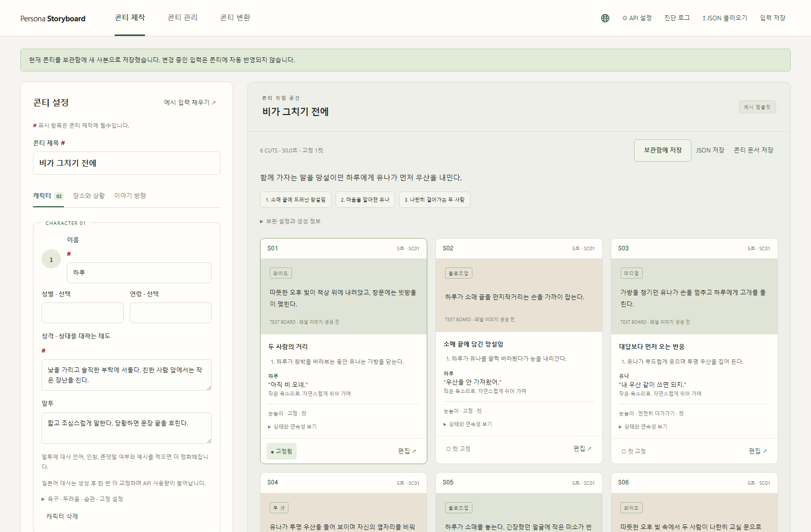
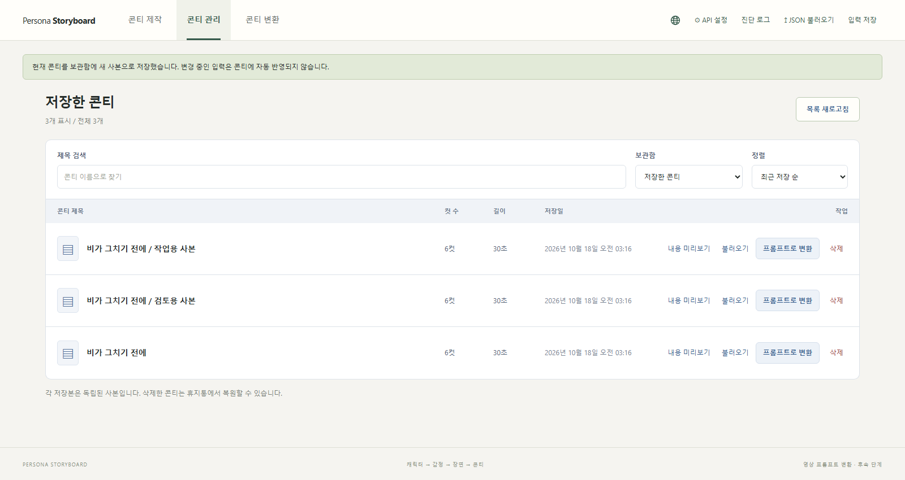
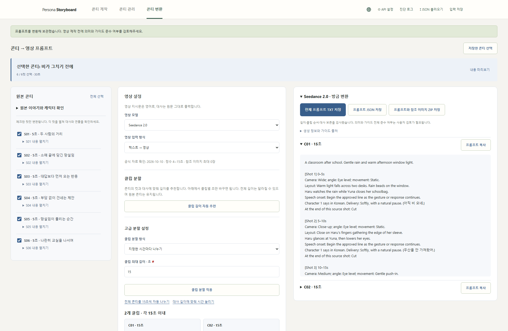
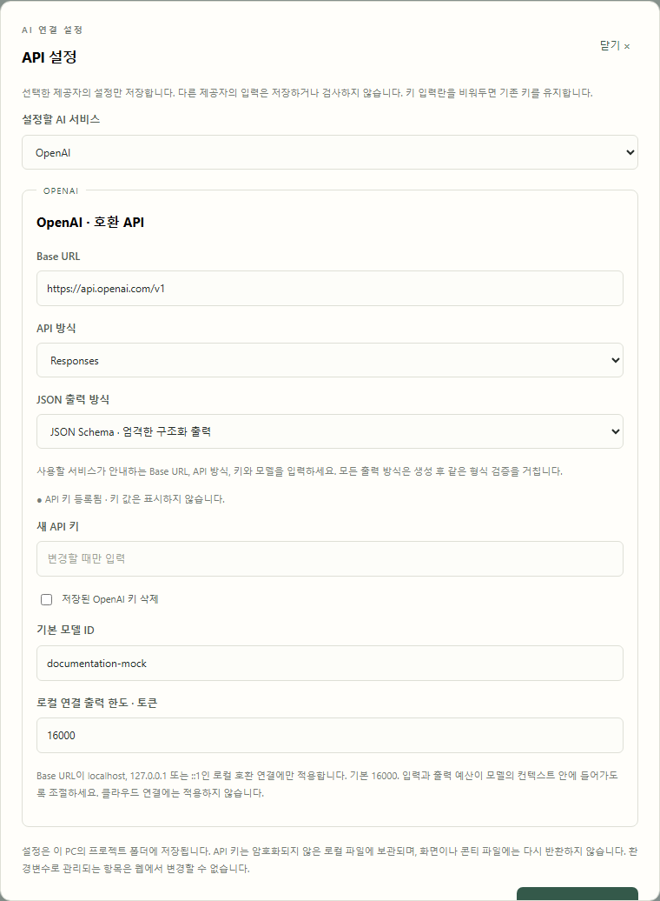

# AI 영상 스토리보드 생성기

[English](README.md) · 한국어 · [日本語](README.ja.md)

[v0.5.6-beta 다운로드](https://github.com/impacifist/ai-video-storyboard-generator/releases/tag/v0.5.6-beta) · [업데이트 내역](docs/releases/v0.5.6-beta.md)

이번 업데이트는 변환 결과의 각 클립 옆에 **프롬프트 복사** 버튼을 추가합니다. 접힌 클립이나 다시 불러온 결과에서도 해당 클립의 프롬프트만 원문 대사·줄바꿈과 함께 복사합니다. 영어·한국어·일본어 설명서의 화면과 예시도 각 언어에 맞췄습니다. 로컬 AI 출력 한도·진단 로그·클립 길이 조절·배경 참조·최대 60컷 생성과 [카메라 기법 75선 및 한국어 참고 이미지](docs/assets/camera-techniques-ko/README.md)는 유지됩니다.

## LTX 2.5 변환

변환 화면에서 **LTX 2.5**와 **텍스트 → 영상** 또는 **시작 이미지 → 영상**을 선택하세요. [공식 자료를 정리한 가이드](docs/guides/ltx-2.5.md)와 [전용 시스템 규칙](docs/guides/ltx-system.md)을 적용합니다. 출력은 시간 순서의 영어 문장으로 구성하며, 원문 대사·승인된 카메라 전환·소리의 연결을 유지합니다. 클립별 복사와 TXT/JSON 저장도 지원합니다.

시작 이미지는 각 클립의 영상 제작 워크플로우에서 직접 연결합니다. 생성기가 이미지를 분석하거나 LTX 노드에 전달하지는 않습니다. 여러 캐릭터·배경 참조 이미지 업로드는 MiniMax/Seedance 참조 모드에서 사용하세요. 현재 분할 범위 4~15초는 앱의 정책이며 LTX 모델의 생성 상한이 아닙니다. 실제 프레임 수와 FPS는 영상 워크플로우에서 설정하고, 생성된 문장을 그대로 시험하려면 Prompt Enhance를 끄세요. 모의 AI로 변환 기능을 검증했으며 실제 영상 품질·클립 연결 품질은 검증하지 않았습니다.

## 화면으로 보는 사용 흐름

아래는 한국어 UI와 한국어 예시 콘티로 촬영한 실제 앱 화면입니다. 직접 작성한 예시와 모의 AI 응답을 사용했으며, 실제 유료 모델의 생성 품질을 보여주는 자료는 아닙니다.

**캐릭터 설정 → 컷별 콘티 편집**: 캐릭터를 1~5명까지 추가·삭제하고 성격과 말투를 입력합니다. 목표 길이 10~180초에 컷 수 3~60개를 설정할 수 있으며 길이에 따른 권장 컷 수를 표시합니다. 13컷 이상 AI 생성·재생성은 전체 흐름을 먼저 설계한 뒤 최대 6컷씩 상세화하며, 직전 컷과 고정 컷의 맥락을 전달합니다. API 호출과 비용이 늘어나며 모든 묶음을 검증한 뒤 완성본을 반환합니다. 호출별 출력 예산은 16,000토큰으로 유지합니다. 중간 실패 시 일부 결과를 완성본으로 저장하지 않으며 자동 재시도하지 않습니다. 대사·행동·카메라·연속성 상태를 확인하고 유지할 컷은 고정할 수 있습니다.

성별과 연령은 선택 입력입니다. 말투에는 대사 언어, 인칭, 존댓말 여부와 예시를 함께 적을 수 있습니다. 일본어 생성 대사는 같은 AI로 한 번 더 교정하며, 긴 대사 목록은 최대 12행씩 분할 호출하므로 API 사용량이 늘어납니다. 고정 컷과 입력에 명시한 원문 대사는 교정 대상에서 제외하며, 어느 묶음이든 교정 실패 시 생성본의 대사를 유지하고 검수 경고를 표시합니다. AI 교정이 원어민 수준의 품질을 보장하지는 않습니다. 영상 변환에서는 승인된 대사를 그대로 보존합니다.



**보관함 관리**: 저장한 콘티를 검색하고 미리보기·불러오기·변환·휴지통 이동·복원으로 관리합니다.



**30초 콘티 → 15초 프롬프트 2개**: Seedance 2.0, MiniMax H3 또는 LTX 2.5를 선택하고, 원본 컷·분할 계획·결과를 나란히 검토합니다. 전체 프롬프트는 TXT로, 참조 이미지는 ZIP으로 받을 수 있습니다. 영상 지시문은 영어로 작성하고, 한국어 대사는 원문 그대로 유지합니다.



**브라우저에서 API 설정**: OpenAI·호환 API, Claude, Ollama, LM Studio 중 사용할 연결을 설정합니다.



[한국어 예시 콘티 JSON](examples/before-the-rain-stops.ko.storyboard.json)을 저장해 **JSON 불러오기**로 열면 API 키 없이 내용을 확인하고 편집할 수 있습니다. 변환 화면에서 사용할 때는 먼저 보관함에 저장하세요. [한국어 대사가 포함된 예시 출력 TXT](examples/before-the-rain-stops.ko.prompts.txt)도 함께 제공합니다. 실제 AI 변환에는 본인의 API 설정이 필요합니다.

예시는 하루가 소매 끝을 만지며 망설이는 장면에서 시작합니다. 유나가 마음을 알아채 함께 우산을 쓰자고 제안하고, 하루가 안도하며 둘이 나란히 교실을 나서는 여섯 컷으로 구성되어 있습니다. 각 컷은 5초이며, 변환 결과는 **C01: 0~15초 / C02: 15~30초**로 나뉩니다.

소개 화면을 다시 촬영하려면 개발용 Playwright와 Chromium을 설치한 뒤 `python tools/capture_showcase.py --language ko`를 실행하세요. 임시 보관함과 모의 AI를 사용하므로 개인 설정이나 저장한 콘티를 읽지 않습니다.

캐릭터 페르소나, 인물 관계, 장소와 상황, 사용자의 이야기 방향을 입력받아
대사·행동·영상 연출을 포함한 편집 가능한 콘티를 제작하는 독립 프로젝트입니다.

## 현재 상태

로컬에서 실행하는 첫 웹앱을 구현했습니다. Python 3.12 이상과 브라우저만 있으면
실행할 수 있으며, 앱 실행에 추가 Python 패키지는 필요하지 않습니다.

- 캐릭터 1~5명과 관계·장소·상황·이야기 방향 입력
- 입력 JSON 및 프로젝트 JSON 불러오기
- Ollama, OpenAI, Claude, LM Studio 중 제공자와 모델 선택
- 컷별 화면·대사·행동·카메라·시작/종료 상태 생성
- 컷 편집·고정·수정 요청에 따른 재생성
- 형식·화자·시간·상태 연결 검사와 별도 AI 의미 검수
- 프로젝트 JSON 및 콘티 Markdown 다운로드

- 필수 입력 항목의 빨간 `#` 표시와 누락 항목 자동 포커스
- 지구본 메뉴에서 한국어·영어·일본어 UI 전환, 브라우저에 언어 선택 저장
- 생성한 콘티 자동 보관, 제목 검색·다시 열기·휴지통·복원
- 저장한 콘티 내용 미리보기, 컷별 대사·행동·카메라·연속성 확인
- Seedance 2.0 / MiniMax H3 / LTX 2.5 공식 가이드 선택과 최대 15초 프롬프트 변환
- 캐릭터별 여러 참조 이미지의 용도·설명·순서 관리, 프롬프트와 이미지 ZIP 내보내기

이미지 콘티와 실제 영상 생성은 아직 구현하지 않았습니다. 공식 가이드 요약과 시스템
프롬프트는 `docs/guides`에 있으며, 직접 입력 가이드도 고급 옵션으로 유지합니다.

## 실행

Windows에서 `start.bat`를 실행하거나 프로젝트 폴더에서 다음 명령을 실행하세요.

```powershell
python server.py
```

브라우저에서 <http://127.0.0.1:8765>를 여세요. 서버를 종료하려면 `Ctrl+C`를 누르세요.
포트가 사용 중이면 `python server.py --port 8766`처럼 바꿀 수 있습니다.

먼저 **예시 콘티 체험하기**로 편집·고정·저장 흐름을 확인할 수 있습니다.
예시 모드는 고정 템플릿이며 입력의 의미나 페르소나를 해석하지 않습니다.
AI 생성이 실패해도 예시 결과로 자동 대체하지 않습니다.

## AI 연결 설정

**지원하는 모든 로컬 연결의 출력 예산을 조절할 수 있습니다.** API 설정 → Ollama·LM Studio의 요청 출력 한도, 또는 OpenAI의 로컬 연결 출력 한도에서 설정하세요. 제공자별로 저장하며 기본 16000, 범위 256~131072이고 제작·검수·변환에 적용합니다. Ollama는 [`options.num_predict`](https://docs.ollama.com/modelfile), 로컬 호환 Chat Completions/Responses는 `max_tokens`/`max_output_tokens`로 전송합니다. 호환 연결 설정은 `localhost`, `127.0.0.1`, `::1`에만 적용하며 클라우드 출력 한도는 유지합니다. 환경변수는 `OLLAMA_MAX_TOKENS`, `LMSTUDIO_MAX_TOKENS`, `OPENAI_LOCAL_MAX_TOKENS`입니다. 출력 예산 설정이며 모델의 컨텍스트 길이·추론 모드를 변경하지는 않습니다.

**LM Studio 출력 예산:** API 설정 → LM Studio → 요청 출력 한도에서 `max_tokens`를 조절할 수 있습니다(기본 16000, 범위 256~131072). 저장한 값은 콘티 제작·검수·변환에 적용됩니다. 추론도 같은 출력 예산을 사용할 수 있으므로 입력 토큰과 출력 한도의 합이 모델에 설정한 컨텍스트 길이를 넘지 않게 조절하세요. 한도를 높여도 완성은 보장되지 않습니다. 앱은 잘린 응답을 자동 재시도하거나 미확인 추론 제어 옵션을 보내지 않습니다. 추론에 출력 예산 대부분을 사용했다면 모델의 추론 설정도 확인하세요. `.env` 또는 환경변수의 `LMSTUDIO_MAX_TOKENS`로도 설정할 수 있으며 환경변수 관리 항목은 웹에서 변경할 수 없습니다. [공식 지원 파라미터](https://lmstudio.ai/docs/developer/openai-compat/chat-completions).

상단 **진단 로그** 또는 오류 옆 **진단 로그 보기**에서 AI 요청 상태, 경과 시간, 종료 사유, 토큰 사용량(서버가 제공하는 경우 추론 토큰 포함), 요청 출력 한도와 HTTP 상태를 확인할 수 있습니다. 로그 복사·TXT 저장으로 오류를 공유하세요. 최근 200건을 메모리에만 보관하며 서버 재시작 시 초기화됩니다. 이전 오류를 소급 조회할 수는 없습니다. 요청·응답 본문, API 키, 서버 주소는 기록하지 않습니다. 요청 성공은 전체 콘티 검증 통과를 의미하지 않습니다. `length`로 종료되고 출력 대부분이 추론 토큰이라면 컨텍스트를 늘리기 전에 모델의 추론 모드나 추론 예산을 확인하세요.

**LM Studio**는 Developer 탭에서 모델을 로드하고 서버를 시작한 뒤, 앱의 **API 설정 → LM Studio**에서 모델 ID를 입력해 저장하면 됩니다. 기본 주소는 `http://127.0.0.1:1234/v1`이며 Chat Completions와 JSON Schema를 사용합니다. 서버 인증을 켠 경우에만 선택 API 키를 입력하세요. 모델에 따라 JSON 모드·프롬프트 JSON으로 직접 바꿀 수 있습니다. OpenAI의 주소·모델·키와 별도로 저장하며 로컬 주소만 허용합니다. 설정 저장만으로 모델을 호출하지 않습니다. [공식 연결 안내](https://lmstudio.ai/docs/developer/openai-compat) · [인증 안내](https://lmstudio.ai/docs/developer/core/authentication)

상단 지구본 아이콘으로 한국어·English·日本語를 선택할 수 있습니다. 메뉴, 설정창,
입력 안내, 검수·오류 메시지를 전환하며 페르소나·콘티·대사·프롬프트 원문과 입력 중인
값은 유지합니다. UI 언어 선택은 생성물의 언어를 자동으로 변경하지 않습니다.
첫 접속의 기본 UI 언어는 영어입니다. 저장된 선택이 있으면 해당 언어를 유지하며,
저장소 접근이 차단되거나 저장된 언어 코드가 유효하지 않으면 영어로 시작합니다.
브라우저 저장소에는 언어 코드만 저장하며, 키나 콘티는 저장하지 않습니다.
브라우저가 저장소 사용을 차단해도 현재 페이지에서는 언어를 전환할 수 있습니다.


상단 **API 설정**에서 Ollama 주소, 제공자별 기본 모델, OpenAI·Claude 키를 등록할 수
있습니다. 설정할 제공자를 선택하면 그 제공자의 항목만 저장하며, 다른 제공자의 입력은
검사하거나 전송하지 않습니다. 저장 즉시 적용되며 재시작은 필요하지 않습니다. 키 입력란을 비워두면 기존
키를 유지하고, 삭제 체크박스로 해당 키를 제거할 수 있습니다. 저장만으로 AI를 호출하지
않으며 연결 검증은 생성 또는 의미 검수 요청 시 수행합니다.
Ollama 주소는 선택 입력입니다. OpenAI만 사용하면 비워두어도 저장할 수 있으며,
빈 주소는 기존 주소 또는 기본 로컬 주소를 유지합니다.

웹 설정은 Git에서 제외된 `.local-secrets/ui-settings.json`에 원자적으로 저장합니다.
API 키는 암호화되지 않은 로컬 파일에 보관됩니다. PC와 프로젝트 폴더 접근 권한을
관리해주세요. 키는 설정 조회 응답·콘티 파일·브라우저 저장소에 포함하지 않습니다.
설정창을 닫으면 입력한 키는 비웁니다.

설정 우선순위는 **프로세스 환경변수 > 웹 설정 > .env**입니다. 환경변수로 관리되는
항목은 화면에서 비활성화하고 서버에서도 변경을 차단합니다. 웹에서 키를 삭제하면
기존 `.env`의 키도 적용되지 않게 빈 값으로 덮어 지정하며 `.env` 자체는 수정하지 않습니다.

파일로 관리하려면 `.env.example`을 `.env`로 복사하고 사용할 제공자의 항목만 채우세요.
기존 `.env`가 있다면 덮어쓰지 말고 필요한 항목만 편집하세요.

| 제공자 | 키 | 모델 설정 | 요청 방식 |
|---|---|---|---|
| Ollama | 필요 없음 | `OLLAMA_MODEL` 또는 화면에서 입력 | 로컬 `/api/chat` |
| OpenAI | `OPENAI_API_KEY` | `OPENAI_MODEL` 또는 화면에서 입력 | Responses API |
| Claude | `ANTHROPIC_API_KEY` | `CLAUDE_MODEL` 또는 화면에서 입력 | Messages API |

### OpenAI 호환 서비스

서버 코드를 업데이트했다면 실행 중인 서버를 한 번 종료하고 `start.bat`로 다시 실행하세요.
상단 **API 설정 → OpenAI**에서 사용할 서비스의 연결 정보를 입력하세요.

| 항목 | 설정 방법 |
|---|---|
| Base URL | 사용할 서비스가 안내하는 API 기본 주소 |
| API 방식 | 서비스가 지원하는 Responses 또는 Chat Completions |
| JSON 출력 방식 | 모델이 지원하는 JSON Schema, JSON 모드 또는 프롬프트 JSON |
| API 키 | 사용할 서비스에서 발급받은 키 |
| 기본 모델 ID | 사용할 서비스에서 제공하는 정확한 모델 ID |

저장 후 제작 엔진에서 **OpenAI**를 선택하세요. OpenAI 호환 서비스를 통해 다른 모델을
사용하는 경우에도 이 연결 방식을 사용합니다. 입력과 콘티는 화면에 표시된 주소로 전송됩니다.

다른 OpenAI 호환 서비스는 Base URL과 API 방식을 직접 입력할 수 있습니다. 기본 주소만
입력하고 `/chat/completions`나 `/responses`는 붙이지 마세요. 원격 주소는 HTTPS만
허용하며 HTTP는 로컬 주소만 지원합니다. 주소에 사용자 정보·쿼리·API 키를 넣을 수 없습니다.
API 대상 호스트를 변경할 때는 새 서비스의 키를 입력하거나 기존 키를 삭제해야 합니다.

JSON Schema 지원 모델은 엄격한 구조화 출력을, JSON 모드만 지원하면 JSON 모드를,
두 형식 옵션을 지원하지 않으면 프롬프트 JSON을 선택하세요. 모든 방식에서 앱의 형식·참조
검증은 유지합니다. 형식 오류가 나도 다른 API나 출력 방식으로 자동 재시도하지 않습니다.
프롬프트 JSON은 모델이 구조를 따르지 않을 수 있어 모델별 실제 생성 품질을 확인해야 합니다.

근거: [OpenAI 구조화 출력 문서](https://developers.openai.com/api/docs/guides/structured-outputs?api-mode=chat).

모델 ID는 직접 지정합니다. 해당 계정 또는 로컬 설치에서 사용 가능하고 선택한 출력
방식과 호환되는 모델을 선택하세요. 앱은 모델을 자동 다운로드하지 않습니다.
Ollama는 별도 설치·실행이 필요하며 기본 연결 주소는 `http://127.0.0.1:11434`입니다.
`OLLAMA_BASE_URL`은 경로 없는 로컬 HTTP 주소만 허용합니다.
Ollama에서 클라우드 모델을 선택하면 Ollama를 통해 외부 전송이 일어날 수 있습니다.

저장된 키 값은 서버에서 읽고 브라우저·프로젝트 JSON에 다시 반환하지 않습니다. 설정은
요청 시 다시 읽으며 `.env`를 직접 바꾼 경우 화면을 새로고침해 설정 여부를 갱신하세요.
생성·재생성·AI 의미 검수는 각각 요청 1회를 수행합니다. OpenAI·Claude 사용 시 비용이
발생할 수 있습니다. 화면의 전송 확인란을 선택하고 버튼을 눌렀을 때만 호출합니다.
타임아웃이나 거절·형식 오류는 표시하며 자동 재시도하지 않습니다.

## 저장과 검수

입력 저장은 설정만, 프로젝트 JSON 저장은 입력·콘티·고정 상태·수정 이력을 보관합니다.
콘티 문서는 Markdown으로 내려받습니다. 자동 디스크 저장이나 브라우저 자동 저장은
하지 않으므로 창을 닫기 전에 JSON으로 저장하세요. 실제 대사 낭독 시간은 측정하지 않습니다.

고정 컷은 재생성 응답과 관계없이 코드가 원본을 보존합니다. 고정 컷이 있을 때는 원본
설정을 바꿀 수 없습니다. 전체 설정을 바꾸려면 고정을 해제하거나 새 콘티를 생성하세요.
수동 편집 뒤에는 모든 컷의 상태 연결을 다시 검사하고 이전 AI 검수 의견을 무효화합니다.
의미가 같은 상태라도 표현이 다르면 연결 경고가 날 수 있으므로 사용자 판단이 필요합니다.
필수/제외 요소 검사는 줄별 문자열 검사이며 의미적 준수를 보장하지 않습니다.

AI 의미 검수는 선택한 제공자로 별도 요청합니다. 생성 모델과 다른 제공자로 검수할 수도
있습니다. 검수는 의견이며 페르소나 일관성이나 영상 품질에 대한 보증이 아닙니다.
생성 출처는 기록하지만, 직접 수정·임포트 가능한 파일의 진위를 인증하지는 않습니다.

## 검증

```powershell
python -m unittest discover -s tests -v
node --check web/app.js
```

선택 검사: Ruff가 설치되어 있으면 `python -m ruff check server.py storyboard tests`.
Playwright와 Chromium이 설치되어 있으면 `python tests/browser_smoke.py`로 브라우저
흐름을 검증합니다. 브라우저 테스트의 AI 응답은 모의 응답이며 실제 제공자에 전송하지
않습니다. 스크린샷은 ignored `storage/browser-check` 아래에 기록합니다.
`python tests/browser_settings.py`는 임시 디렉터리와 가짜 키로 설정창을 검사하며,
실제 설정 파일을 읽거나 수정하지 않습니다.

이 서버는 개인용 로컬 개발 앱입니다. `127.0.0.1`에만 바인딩하며 인증·다중 사용자·공개
배포 기능은 포함하지 않습니다. 허용된 정적 파일만 제공하고 다른 Origin의 요청을 차단합니다.

## 제작 흐름

1. 캐릭터·관계·장소·상황 입력 또는 임포트
2. 고정 설정과 변화 가능한 상태 정리
3. 장면 목표와 감정 변화 설계
4. 페르소나에 맞는 대사와 행동 작성
5. 컷 분할과 카메라·구도·타이밍 설계
6. 캐릭터 일관성 및 장면 연속성 검수
7. 사용자가 수정할 수 있는 콘티 출력

콘티 원본은 특정 영상 모델의 프롬프트 문법에 종속시키지 않습니다.
두 번째 기능인 **콘티 변환**에서 저장한 콘티를 불러와 변환할 컷을 선택합니다.
기본 사용법은 **클립 길이 자동 추천 → 클립별 초 수정 → 변환**입니다.
변환 시 대사마다 시작할 행동·반응을 지정하고 인접 클립 양쪽에 같은 연결 설명을 넣습니다.
자동 추천 방식은 사용자가 정한 클립 길이·개수 안에서 대사와 반응의 컷별 시간을 배분합니다.
먼저 들어갈 수 있는 문장을 뒤 구간으로 통째로 미루지 않으며, 원문 대사·화자·컷 순서는 유지합니다.
기존 고정 시간·컷 보존 방식의 시간 배정과 ComfyUI의 모션 컨텍스트·트리밍 설정은 바꾸지 않습니다.
컷 끝을 우선하고 대사 예상 시간을 확보하며, 짧은 마지막 클립이 따로 남지 않도록
앞뒤 묶음을 함께 계산합니다. 15초를 강제로 채우지 않습니다. 길이 입력은 변환 계획에만
반영하며 전체 영상 길이가 달라질 수 있습니다. 기존 콘티·화자·대사는 보존합니다.
소수 초의 정수 변환도 마지막 정지 화면 대신 컷의 연기 시간에 나눠 반영합니다.
대사 예상 시간은 실측이 아니므로 실제 낭독으로 확인하세요. 한 문장이 모델 상한보다 길면
미리보기에서 시간 부족을 안내하며, 대사를 임의로 자르거나 복제하지 않습니다.

기존 방식은 **고급 분할 설정**에 있습니다. **컷·장면 경계 보존** 방식은 같은 장면의 연속 컷을 15초 이내로 묶으며 긴 단일
컷은 편집을 요청합니다. **전체 콘티를 15초씩 자동 나누기** 버튼은 모든 컷을 선택하고
시간 기준 방식으로 계획합니다. 실제 컷 길이 합이 30초이면 0~15초 / 15~30초의
두 프롬프트를 만듭니다. 전체 목표 길이 입력값보다 실제 저장된 컷들의 길이를 따릅니다.

시간 경계가 컷 중간이면 원본 컷의 부분 범위를 기록하고 다음 클립에서 이어갑니다.
대사 묶음이 들어갈 여유가 있는 조각을 먼저 선택합니다. 묶음이 들어가지 않으면 원문
문장을 자르지 않고 순서를 유지해 조각에 배치합니다. 실제 배정은 미리보기에서 확인하세요.
잘린 컷의 중간에는 원본 시작/종료 상태를 다시 강제하지 않습니다. AI가 공유 경계의 상태를
한 번 반환하고 프로그램이 이전 구간 끝과 다음 구간 시작에 똑같이 삽입합니다.
선택에서 빠진 컷은 연결하지 않으며 고정 시간 방식은 원본 길이를 바꾸지 않습니다.

**대사 시간 확보 · 클립 추가 허용**은 선택한 컷의 대사를 초당 5자 + 컷별 0.5초 여유로
추정해 필요한 컷 길이를 늘리고, 15초 이하로 묶습니다. 낭독 실측이 아닌 편집용 추정입니다.
원본을 수정하지 않으며 늘어난 전체 길이와 클립 수를 미리 확인할 수 있습니다. 단일 컷이
상한을 넘으면 컷/대사를 먼저 나눠야 합니다. 긴 대사를 자동으로 잘라내거나 빨리 읽게 하지 않습니다.

전체 이야기의 길이·결말·필수 이벤트는 전체 콘티의 맥락이며, 부분 선택이나 개별 클립에
모두 들어갈 의무가 아닙니다. 선택한 구간에 결말이 없다는 이유로 위반을 보고하지 않도록
범위를 분리했습니다. 실제 선택 구간 내부의 충돌과 대사 누락 검사는 유지합니다.

변환 화면에서 Seedance 2.0, MiniMax H3 또는 LTX 2.5와 텍스트/캐릭터 이미지 참조 방식을
선택하고 변환용 AI 연결과 전송 동의를 설정하세요. 2026-10-10 확인한 공식 자료의
요약·출처·시스템 프롬프트를 화면에서 확인할 수 있습니다. 매 실행마다 웹을 수집하지
않으며 서버가 내장 가이드를 적용합니다. 공식 프로필은 정수 4~15초 클립만 허용합니다.
소수점 길이나 4초 미만의 구간은 원본 컷·대사 시간을 유지한 채 마지막 화면 유지 시간을 덧붙여 정수 초로 맞춥니다.
예를 들어 7.4초 구간은 0.6초의 화면 유지를 추가해 8초 클립으로 변환하며, 추가 시간은 계획과 프롬프트에 명시합니다.
원본을 수정하지 않으며 클립 수·순서·대사 보존, H3 필수 섹션 순서와 이미지 번호
일치를 검사합니다. 실제 가이드 충돌은 저장을 막습니다. 글자 수 기반 시간 부족 추정,
낭독 속도 검토나 이미 해결한 상태 연결은 비차단 검토 메모로 구분하며 화면과 TXT에 포함합니다.
변환 AI는 완성 프롬프트 대신 컷별 연출과 배경·음향 요소만 구조화해 반환합니다.
프로그램이 원본 대사·화자를 해당 컷에 삽입하고 구간 시간·H3 섹션과
`<d>[언어]...</d>` / 씨댄스 `{...}` 표기를 조립합니다. AI가 원문을 다시 작성할 필드는
없습니다. 컷 누락·순서 변경·임의 필드·연출에 섞인 대사 태그는 거부합니다.
새 변환에는 `assembly_version`, 공유 `boundary_states`, 원문·화자·원본 대사 번호·배정 구간을
담은 `dialogue_manifest`를 저장하며
기존 결과는 그대로 열고 JSON으로 내보낼 수 있습니다. 영어 정책 적용 전 결과의 TXT/ZIP은
재변환이 필요합니다. 새 프롬프트는 UI 언어와 무관하게 영어 지시문과 원문 대사로 구성됩니다.
전달 방식과 참조 설명은 AI가 영어로 번역하고 비영문 캐릭터 이름은 Character N으로 연결합니다.
영어가 아닌 문자로 된 연출·상태·음향·전달 방식은 기존 최대 1회 교정 흐름으로 처리합니다.
TXT의 제목·참조 목록·메모도 영어이며 ZIP에는 같은 `video-prompts.txt`가 포함됩니다.
원본 콘티 및 JSON의 원본/검증 메타데이터는 번역하거나 변경하지 않습니다. AI의 연출 의미나 음성 타이밍
정확성까지 자동으로 보증하지는 않습니다. 변환은 정상 출력이면 한 번 호출합니다.
완료된 JSON 출력이 형식·경계 상태 검증에 실패하면 오류 필드와 이전 출력을 전달하여
최대 한 번 추가 호출로 교정합니다. 추가 호출에는 제공자 비용이 발생할 수 있습니다.
교정 결과도 같은 검증을 통과해야 저장됩니다. 통신 실패·응답 잘림·거절·설정 오류는
자동 재시도하지 않습니다. 실제 가이드 충돌 경고는 교정으로 지울 수 없습니다.
가이드 전체의 의미적 준수와 카메라·상태·화자 보존까지 코드로 보증하지 않으므로
변환 결과를 검토한 후 사용하세요. 실제 영상 제작 연동은 후속 범위입니다.
결과 카드의 **전체 프롬프트 TXT 저장**은 해당 변환의 모든 클립을 순서대로 하나의
UTF-8 텍스트 파일에 정리합니다. 구간 번호·길이·원본 시간 범위·참조 첨부 순서를
포함하며 프롬프트 본문과 대사는 그대로 보존합니다. 이전 저장 결과에서도 사용할 수 있습니다.

이미지 참조 방식에서는 각 캐릭터와 배경에 여러 장을 추가할 수 있습니다. 합쳐서 9장, 장당
5MB 이하 PNG/JPEG/WebP를 받습니다. 얼굴·전신·의상·표정·세부 특징 용도와 설명을
입력하고 전역 첨부 순서를 조정하세요. 씨댄스 공식 권장에 따라 얼굴과 전신을 우선하며
합쳐진 다중 시점 캐릭터 시트는 피하는 편이 좋습니다. **참조 설정 저장**으로 용도·설명·
순서·제외를 보관합니다. 업로드는 즉시 로컬 저장되며 제외는 이미지 파일의 영구 삭제가
아닙니다. 텍스트 방식으로 바꿔도 보관한 이미지 설정은 유지됩니다.

변환 화면의 **배경 이미지 추가**에서 장소의 전체 구조와 다른 각도를 등록하세요.
설명에는 적용할 장소와 좌석·문·창문·통로의 위치, 캐릭터가 앉을 자리를 적으세요.
각 클립에 해당 장소의 구조를 카메라 각도와 클립 경계에서도 유지하도록 영어 지시문을
삽입합니다. 배경은 캐릭터 식별용 이미지와 구분하며, 배경 속 인물은 복제하지 않도록 합니다.
변환 AI는 이미지를 시각 분석하지 않으므로 영상 서비스에 배경 이미지도 함께 첨부해야 합니다.
이는 구조의 일관성을 유도하는 기능이며 영상 모델의 결과를 보장하지는 않습니다.

이미지 바이트는 로컬 SQLite에 보관하며 변환 AI에는 캐릭터 ID·파일명·용도·설명만
전송합니다. 이미지 내용을 시각 분석하지 않습니다. 변환 결과의 **프롬프트와 참조 이미지
ZIP 저장**에서 당시 이미지와 `manifest.json`을 받으세요. 영상 서비스에는 각 클립마다
manifest 순서로 직접 첨부해야 합니다. H3는 `<Picture N>`, 씨댄스는 `Image N`을
사용합니다. 이후 설정을 바꿔도 과거 결과의 첨부 목록과 이미지 바이트는 유지됩니다.

콘티와 변환 결과는 Git에서 제외된 `storage/library/storyboards.sqlite3`에 보관합니다.
생성 시 자동 저장하며 편집 후에는 **보관함에 저장**으로 새 사본을 만들 수 있습니다.
삭제는 복원 가능한 휴지통 이동입니다. 기존 JSON은 불러온 뒤 보관함에 저장하세요.
저장소는 이 PC에서 공유되는 개인용 보관함이며 사용자 계정별 격리는 지원하지 않습니다.

추가 검증: `python tests/browser_library.py`는 임시 보관함과 모의 AI로 저장·검색·복원과
클립 계획·변환 결과 재불러오기를 확인합니다. 실제 과금 호출은 하지 않습니다.
`python tests/browser_i18n.py`는 세 언어, 선택 유지, 입력·콘티 원문 보존,
서버 오류 번역, 키보드 조작과 화면 폭별 배치를 외부 AI 호출 없이 검사합니다.
`python tests/browser_conversion.py`는 원본 확인, 공식 프로필, 캐릭터별 가변 이미지,
순서 변경·저장·재접속, 두 모델 변환, ZIP 원본 일치와 모바일 UI를 모의 AI로 검증합니다.

## 문서

- [MVP 요구사항과 완료 기준](docs/MVP.md)
- [설계와 제공자 API 근거](docs/ARCHITECTURE.md)

첫 버전은 Python 표준 라이브러리 HTTP 서버와 HTML/CSS/JavaScript로 구성합니다.
