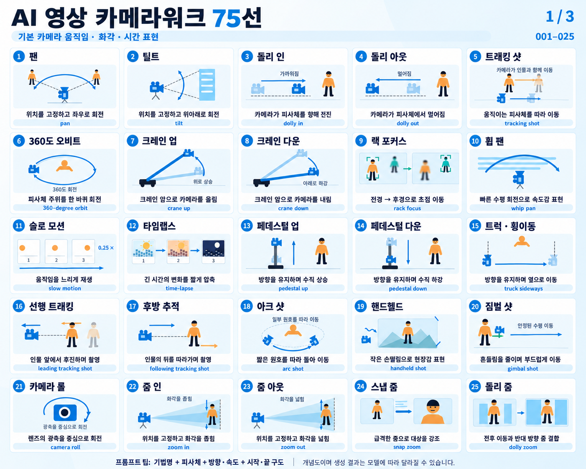
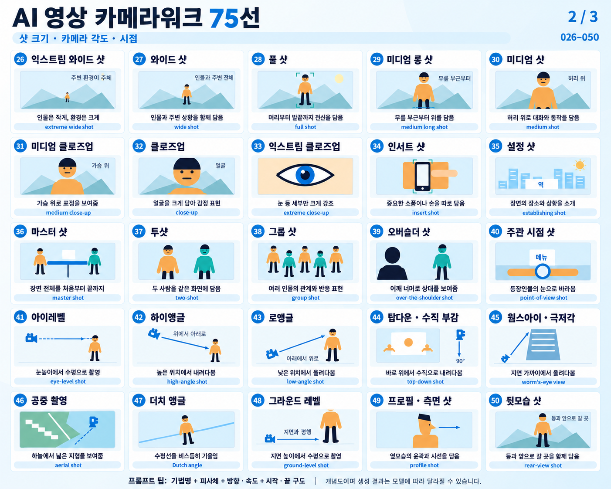
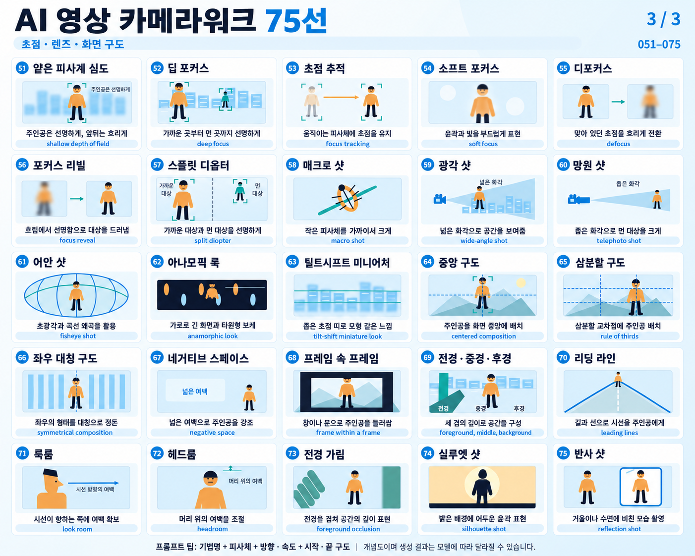

# 한국어 카메라워크 참고 이미지

[전체 번역·복사용 프롬프트](../../guides/camera-techniques.ko.md) · [이미지 제작 프롬프트](generation-prompts.md)

## 1. 기본 움직임·화각·시간 표현 (001~025)

## 2. 샷 크기·각도·시점 (026~050)

## 3. 초점·렌즈·구도 (051~075)

이 이미지는 연출 선택을 위한 참고 자료입니다. 앱은 번역된 텍스트 지침을 콘티 생성·재생성·검수와 영상 프롬프트 변환에 사용합니다. 이미지 파일을 매 요청마다 전송하거나 콘티 그림을 생성하는 기능은 포함하지 않습니다.
